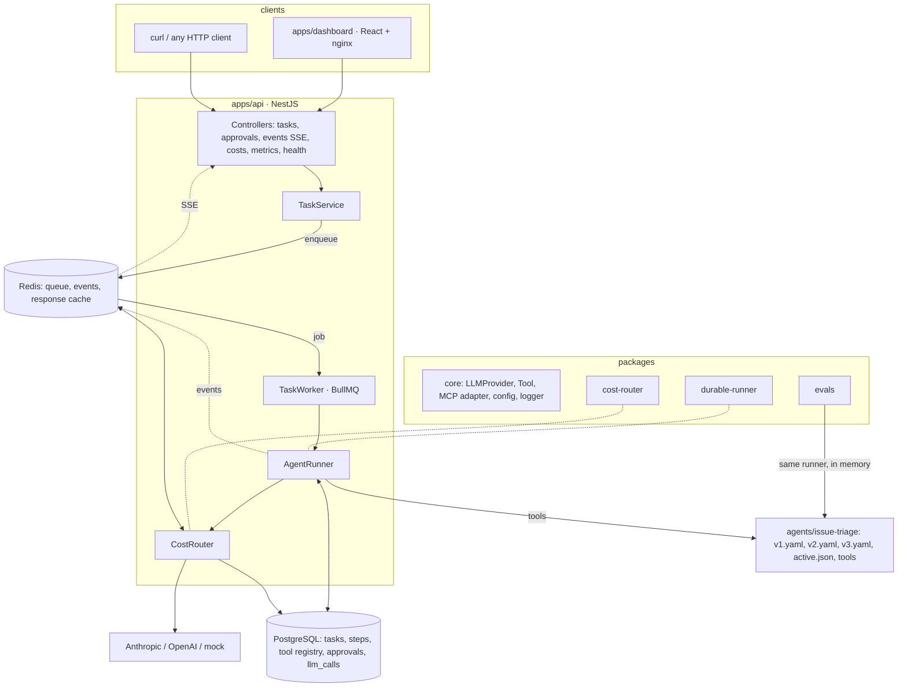
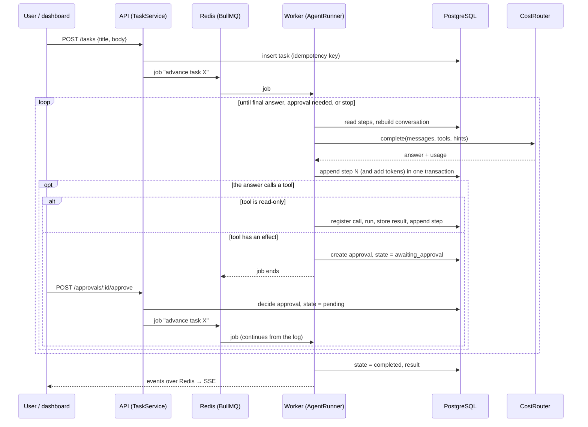

# Architecture

This page explains how the pieces fit and what happens when something fails. Decisions that were
not dictated by the brief are in [decisions/](decisions/README.md).

## Components

| Package                   | Responsibility                                                                                    | Depends on                    |
| ------------------------- | ------------------------------------------------------------------------------------------------- | ----------------------------- |
| `packages/core`           | Provider and tool interfaces, mock/Anthropic/OpenAI providers, MCP client adapter, config, logger | none                          |
| `packages/durable-runner` | Step log, tool registry, approvals, retries, budget, cancellation, queue, events                  | core                          |
| `packages/cost-router`    | Policy routing, fallback, response cache, call log, Prometheus metrics                            | core                          |
| `packages/evals`          | Suites, graders, baseline gate, promote/rollback, in-process executor                             | core, durable-runner, agents  |
| `agents/issue-triage`     | Versioned definitions, simulated tools, scripted mock model                                       | core                          |
| `apps/api`                | Wiring and REST/SSE/metrics endpoints                                                             | all of the above except evals |
| `apps/dashboard`          | Tasks, approvals, costs. Talks to the API only                                                    | none                          |

Dependencies point one way: apps → packages → core. The runner does not know about the router, and
the router does not know about the runner: they meet at the `LLMProvider` interface.

## One task, end to end

## Data model

| Table             | Key                                              | Purpose                                                                            |
| ----------------- | ------------------------------------------------ | ---------------------------------------------------------------------------------- |
| `agent_tasks`     | `id`; unique `idempotency_key`                   | State machine, token budget and usage, result, cancel flag                         |
| `task_steps`      | `(task_id, seq)`                                 | Append-only log of model calls and tool results; the source of truth               |
| `tool_executions` | `(task_id, step_seq, args_hash)`                 | Registry that makes an effectful tool run at most once                             |
| `approvals`       | `id`; unique `(task_id, step_seq, tool_call_id)` | Pending and decided human approvals                                                |
| `llm_calls`       | `id`                                             | One row per model attempt: model, tokens, cost, latency, cache hit, fallback       |
| `sandbox_effects` | `id`                                             | The demo agent's simulated "GitHub": every effect, without a uniqueness constraint |

States: `pending → running → (awaiting_approval ⇄ running) → completed | failed | budget_exceeded | cancelled`.
Every transition is a compare-and-set on the previous state.

## What happens when something fails

| Failure                                     | Result                                                                                                                                                                            |
| ------------------------------------------- | --------------------------------------------------------------------------------------------------------------------------------------------------------------------------------- |
| Worker killed mid-task                      | BullMQ notices the lost lock, re-queues the job, another worker continues from the last step. Finished steps are not replayed (`pnpm crash-demo`).                                |
| Killed between an effect and its checkpoint | The registry holds the stored result: the effect is not repeated, the result is replayed. If even the result was lost, the agent is told "outcome unknown" instead of re-running. |
| Two workers advance the same task           | They collide on `(task_id, seq)`; one stops quietly. Effects are protected by the registry.                                                                                       |
| Provider returns a transient error          | The router tries the fallback model; the runner then retries with exponential backoff (4 attempts by default).                                                                    |
| Provider returns a non-recoverable error    | The task fails with the error; no retry.                                                                                                                                          |
| Redis loses a wake-up job                   | `TaskService.reconcile()` at startup re-wakes tasks whose approval was decided but never resumed.                                                                                 |
| Redis cache unavailable                     | The router logs and calls the model directly.                                                                                                                                     |
| Call tracking database write fails          | The model call still succeeds; the failure is logged.                                                                                                                             |
| Token budget reached                        | The task stops as `budget_exceeded`; no new model or tool call starts.                                                                                                            |
| Human denies a tool call                    | The denial and its reason are returned to the agent as the tool result; the agent decides what to do next.                                                                        |
| Task is cancelled                           | Immediately if idle or waiting for approval; at the next checkpoint (and aborting an in-process model call) if running.                                                           |

## Observability

- **Logs**: pino, one JSON object per line, redacting keys named `apiKey`, `authorization`, `password`.
- **Metrics** (`GET /metrics`, Prometheus): `agent_tasks`, `agent_tasks_finished_total`,
  `agent_tool_calls_total`, `agent_llm_retries_total`, `llm_calls_total`, `llm_tokens_total`,
  `llm_cost_usd_total`, `llm_cache_saved_usd_total`, `llm_call_latency_seconds`, plus Node process metrics.
- **Events**: task lifecycle events on Redis, streamed at `GET /events` (SSE) to the dashboard.
- **Costs**: `GET /costs` (aggregated in SQL, with the price list and its sources) and `GET /costs/calls`.
- **OpenTelemetry** (optional): set `OTEL_EXPORTER_OTLP_ENDPOINT` and the API exports traces (OTLP/HTTP).
  Spans: `llm.complete` and `tool.execute`, with task, agent and tool attributes. Without the variable the SDK is
  not even loaded.

## Configuration

Environment variables are validated at startup ([`.env.example`](../.env.example)). `LLM_PROVIDER`
defaults to `mock` and a key alone does not change it ([ADR 0003](decisions/0003-explicit-llm-provider.md)).
Pricing and routing live in [`config/`](../config). Agent versions and the deployed version live in
[`agents/issue-triage/`](../agents/issue-triage).

## Deployment shape

`docker compose up` starts PostgreSQL, Redis, the API (which also runs a BullMQ worker in-process) and
the dashboard (nginx serving the build and proxying `/api`, including SSE). Workers can also be started as
separate processes sharing the same PostgreSQL and Redis, which is how the crash demo works.

## Limits

No authentication or multi-tenancy; single Redis and PostgreSQL instances; no Kubernetes manifests;
tool calls of one model turn run sequentially; a model call interrupted by a crash is paid again.
